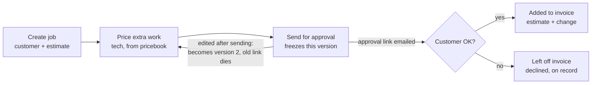
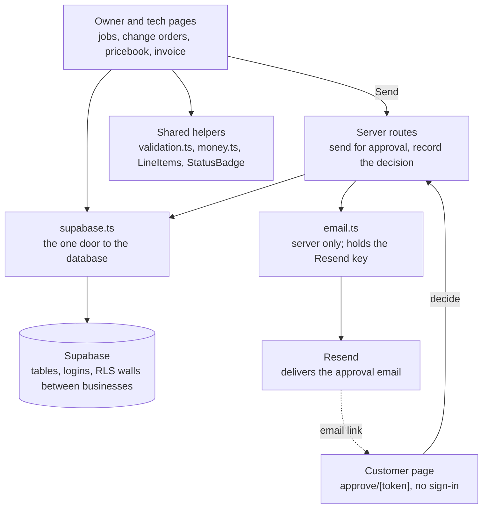

# Plumbing Change-Order App — Lean Build Plan

Oct 22, 2026 · Ryan

This file has two parts:

- **Part 1: The plan** (what we're building, stack, data model, files, milestones)
- **Part 2: Build guide** (20 chunks, each with the prompt to paste into the AI coding assistant)

---

# Part 1: The plan

## What we're building

Version 1 is a web app that turns a plumber's on-site discovery into a customer-approved change order and an accurate invoice. It is the "field-to-cash" idea from the earlier ChatGPT plan, cut down to the one workflow that is actually the product.

**Who it's for:** small plumbing shops (owner plus 1–10 techs), starting with one real tester: a plumber friend.

**The promise:** "Found more work on site? Price it, get the customer's OK in writing, and have it land on the invoice automatically."

**In v1:**

- One business account with an owner and techs
- Customers and jobs with an original estimate
- A simple pricebook (parts and labor rates)
- Change orders built from the pricebook
- A customer approval link sent by email (approve or decline)
- An invoice that combines the estimate and approved changes, printable as a PDF

**Deliberately not in v1:** native phone app, offline sync, Stripe subscriptions, contractor payment collection, dashboards and charts, CSV import/export, AI features, integrations with Jobber or other CRMs. Each has a trigger for when to add it in the "Deferred features" section.

The app runs in the phone's browser, so techs use it on site with no app store install.

## The four-step spine

Version 1 is done when one job can travel from estimate to invoice with a customer-approved change in between.



The tech never marks work as approved; only the customer's click on the emailed link does.

**Worked example:** The plumber quotes $600 to replace a water heater. On site he finds a corroded shutoff valve, adds "Replace shutoff valve, 1 part + 0.5 hr labor" from the pricebook for $175, and sends it. The homeowner approves on her phone. The invoice shows $775. If she had declined, the invoice stays at $600 and the declined change remains on the job's record.

**Acceptance criteria:**

- A tech can create a change order on a phone screen in under two minutes.
- Prices come from the pricebook but are copied onto the change order, so later price edits don't alter it.
- An approval link works once, expires (start with 7 days), and only for the version it was sent with.
- The customer page shows the business name, the change, the price and nothing internal.
- The invoice total always equals estimate plus approved changes, recalculated on the server.

## Stack, accounts and costs

The stack is one Next.js app plus Supabase. Fewer moving parts means fewer places for a bug to hide while learning.

| Layer | Choice | What it does, in plain words |
| --- | --- | --- |
| Language | TypeScript | JavaScript that checks the shape of your data before the code runs |
| App (office, tech and customer pages) | Next.js + React | Builds the screens and the server code in one project |
| Styling | Tailwind CSS | Spacing, colors and phone-friendly layouts without writing raw CSS |
| Database, login, file storage | Supabase | Postgres database, user accounts, and storage for photos |
| Input checking | Zod | Rejects bad data that arrives from a browser |
| Email | Resend | Sends the customer approval link |
| Hosting | Vercel | Puts the app on the internet so the tester can use it |
| Editor | VS Code + GitHub | Where code is written and its history saved |

**Accounts needed, and when:**

- **Now:** GitHub (free), Supabase (free tier), Node.js installed on the Mac.
- **Before the first real approval email (milestone 4):** Resend (free tier) and a domain name (roughly $10–20/year). DNS verification can take a few days, so start early.
- **When the tester uses it from his own phone:** Vercel. The free Hobby plan is for personal, non-commercial use, so move to Pro (about $20/month) before charging anyone.

**Expected cost:** $0/month during the build, then roughly $45–60/month (Supabase Pro + Vercel Pro + domain) once real customers use it. Check each vendor's pricing page before signing up; these change.

**Why web instead of a native app:** a phone browser can take photos and works well with signal. We lose strong offline support. That's an accepted tradeoff until plumbers report that dead zones are costing them work.

## Data model

Nine tables cover v1. Think of each table as a spreadsheet tab, each row as one record, and IDs as the links between tabs.

| Table | One row is… | Key columns |
| --- | --- | --- |
| `businesses` | A plumbing company | name |
| `members` | A person in that company | business_id, user_id, role (owner / tech) |
| `customers` | A homeowner or property manager | business_id, name, email, phone, address |
| `jobs` | One service visit | business_id, customer_id, assigned_tech_id, status, description |
| `pricebook_items` | A part or labor rate | business_id, name, unit, price_cents |
| `estimate_lines` | A line on the original estimate | job_id, description, quantity_milli, unit_price_cents |
| `change_orders` | Extra work found on site | job_id, version, status (draft / sent / approved / declined), total_cents |
| `change_order_lines` | A line on a change order | change_order_id, description, quantity_milli, unit_price_cents |
| `approvals` | One approval request | change_order_id, version, token_hash, expires_at, decided_at, approver_name, decision |

**Money rules:**

- Store money as whole cents (`17500`, not `175.00`). Decimals cause rounding bugs.
- Store quantity in thousandths (`1000` = 1 unit); forms accept positive whole numbers only.
- The server recalculates every total. Never trust a total sent from the browser.
- Once a change order is sent, its lines are frozen. Editing creates version 2 and kills the old approval link.

**Security rule:** every business-owned table carries `business_id`, and Supabase row-level security (RLS) blocks anyone from reading another company's rows. Test this deliberately with two fake companies.

The invoice is not stored as its own table in v1. It's calculated from estimate lines plus approved change order lines, which keeps it simple until finalized invoice numbers are needed.

## File map

About 25 hand-written files. In Next.js, a `page.tsx` file is a screen and a `route.ts` file is a server endpoint; `[id]` in a folder name means "any job's ID goes here."

| File | What it does | Milestone |
| --- | --- | --- |
| `package.json` | Lists packages and commands (`npm run dev`) | 1 |
| `.env.local` | Secret keys; never committed to GitHub | 1 |
| `.gitignore` | Keeps secrets and junk out of GitHub | 1 |
| `supabase/migrations/001_tables.sql` | Creates the nine tables | 1 |
| `supabase/migrations/003_security.sql` | Row-level security rules per business | 1 |
| `supabase/migrations/004_create_job.sql` | Atomically creates a customer, job, and estimate lines | 2 |
| `supabase/migrations/005_create_change_order.sql` | Atomically creates a draft and snapshots current pricebook prices | 3 |
| `supabase/migrations/006_approval_workflow.sql` | Sends, safely reads, and decides token-based approvals | 4 |
| `supabase/seed.sql` | Two fake plumbing companies with jobs | 1 |
| `src/lib/supabase/config.ts` | Reads and validates the public Supabase URL and publishable/anon key | 1 |
| `src/lib/supabase/server.ts` | Creates a cookie-aware Supabase client for server code | 1 |
| `src/proxy.ts` | Refreshes Supabase auth cookies for Next.js 16 requests | 1 |
| `src/lib/validation.ts` | Zod rules for every form | 2 |
| `src/lib/money.ts` | Shared integer-cent calculations and currency formatting | 2 |
| `src/lib/email.ts` | Server-only Resend approval email function | 4 |
| `scripts/send-test-email.ts` | Sends a test message through the server-only Resend helper | 4 |
| `src/app/layout.tsx` | The frame every page sits inside | 1 |
| `src/app/login/page.tsx` | Sign-in screen | 1 |
| `src/app/login/actions.ts` | Signs in with email and password | 1 |
| `src/app/jobs/page.tsx` | Initial signed-in job list; expanded with job features later | 1 |
| `src/app/jobs/actions.ts` | Signs out | 1 |
| `src/app/jobs/new/page.tsx` | Create a job with customer and estimate | 2 |
| `src/app/jobs/new/JobForm.tsx` | Interactive customer and estimate form | 2 |
| `src/app/jobs/new/actions.ts` | Validates and saves a job on the server | 2 |
| `src/app/jobs/[id]/page.tsx` | One job: estimate, change orders, status | 2 |
| `src/app/jobs/[id]/change/page.tsx` | Build a change order from the pricebook | 3 |
| `src/app/jobs/[id]/change/actions.ts` | Validates and saves a change-order draft | 3 |
| `src/app/jobs/[id]/invoice/page.tsx` | Invoice view, printable to PDF | 5 |
| `src/app/jobs/[id]/invoice/PrintInvoiceButton.tsx` | Opens the browser print dialog for an invoice | 5 |
| `src/app/pricebook/page.tsx` | Owner edits parts and labor rates | 3 |
| `src/app/pricebook/actions.ts` | Validates pricebook changes; database RLS enforces owner role | 3 |
| `src/app/pricebook/PricebookManager.tsx` | Pricebook editing forms and read-only tech view | 3 |
| `src/app/approve/[token]/page.tsx` | What the customer sees: approve or decline | 4 |
| `src/app/approve/[token]/DecisionForm.tsx` | Captures the customer's one-time decision | 4 |
| `src/app/jobs/[id]/SendApprovalButton.tsx` | Sends a draft change order to its customer | 4 |
| `src/app/api/change-orders/send/route.ts` | Freezes the version, creates the link, sends the email | 4 |
| `src/app/api/approvals/decide/route.ts` | Records approve/decline, once only | 4 |
| `src/lib/email.ts` | Sends email through Resend | 4 |
| `src/lib/approval-token.ts` | Creates opaque approval tokens and SHA-256 hashes | 4 |
| `src/lib/approval-decision.ts` | Maps one-time decision outcomes to API responses | 4 |
| `src/components/LineItems.tsx` | Reusable table of parts and labor lines | 3 |
| `src/components/StatusBadge.tsx` | Draft / sent / approved / declined label | 3 |
| `tests/money.test.ts` | Checks the math: rounding, half hours, totals | 3 |
| `tests/approvals.test.ts` | Expired, reused and wrong-version links fail | 4 |
| `docs/re-entry.md` | Running session notes | Every session |

Add files only when a chunk needs them. Don't create empty placeholders to match this list.

### How the files connect

Think of the app like a house: pages are the rooms people walk into, helpers are the shared wiring, and Supabase is the foundation with locked walls between each company.



No page talks to Supabase except through `supabase.ts`, and nothing in the browser ever touches the Resend key.

## Build order

Five milestones, each ending in something the tester can touch. Don't start the next one until the current one can be explained back (next section).

1. **Foundation.** Create the Next.js project, connect Supabase, create the tables and security rules, load two fake companies, and get sign-in working.
   - Done when: signed in as Company A, none of Company B's data is visible, even by typing B's job ID into the URL.
2. **Jobs and customers.** Create a customer, create a job with original estimate lines, list jobs, open one.
   - Done when: a job shows its customer and an estimate total that matches hand math.
   - Friend checkpoint: have him create a real-looking job on his phone without help. Watch where he hesitates.
3. **Pricebook and change orders.** Owner adds parts and labor; tech builds a change order from them; totals calculate in cents.
   - Done when: the money tests pass, including 1.5 hours of labor and odd-cent rounding.
   - Friend checkpoint: ask him to enter a change he actually ran into last month. Does the pricebook match how he prices?
4. **Customer approval.** Send freezes the version and emails a link; the customer approves or declines; the job shows the result.
   - Done when: an expired link, a reused link, and a link to an old version all fail.
   - Friend checkpoint: send an approval to his own email and let him play customer.
5. **Invoice.** Combine the estimate with approved changes; declined and unsent changes stay off; print to PDF.
   - Done when: the $600 + $175 example produces a $775 invoice.
   - Friend checkpoint: would he hand this invoice to a customer? What's missing?

After milestone 5, deploy to Vercel and have the tester use it on one real job.

## How to learn while AI writes the code

The goal is to own the code, not just watch it appear. Use this loop for every feature:

1. **Ask before it builds.** "Before writing code, explain the plan: which files change, what data moves where, and why." Push back if something seems off.
2. **Build one small piece.** One screen or one endpoint at a time, never a whole milestone in one prompt.
3. **Trace it.** Click the button, then follow the data: page → server → database → back. Look at the row in Supabase's Table Editor.
4. **Explain it back.** Write 3–5 sentences in your own words about how it works, then ask: "Find the holes in my explanation."
5. **Break it on purpose.** Ask: "What's one way this could fail? Show me what happens." Then try it.
6. **Commit.** Save to GitHub with a message that says what changed and why.

**Re-entry note** (end of every session, in `docs/re-entry.md`):

- What I built today
- What I understand well enough to explain
- What's still fuzzy
- The exact next step

When stuck, check for a shaky prerequisite before grinding. Most walls in this project trace back to one of four concepts: how a request travels from browser to server, what a database row is, async/await, or authentication vs. authorization. Learn the shaky one with a small example outside the project, then come back.

**Four security checks AI tends to get subtly wrong:** secrets stay in `.env.local`, RLS is on for every table, the server recalculates totals, and approval links are single-use.

## Deferred features and when to add them

Each waits for evidence, not a calendar date.

| Feature | Add it when… |
| --- | --- |
| Photo attachments on change orders | The tester says customers question changes without proof (likely early) |
| Offline saving / native app (Expo + PowerSync) | Plumbers report losing work in basements or dead zones |
| Stripe subscriptions | A plumber other than the friend agrees to pay |
| Finalized invoices with numbers | A tester needs to send invoices that can't change afterward |
| Owner dashboard (pending approvals, ready to bill) | One business has more than a handful of open jobs at once |
| Job costing and margins | Owners ask whether a job made money |
| CSV import/export | A tester wants to move data in from another tool |
| Jobber or other CRM integration | Testers refuse to enter jobs twice; check the vendor's API first |
| Contractor payment collection (Stripe Connect) | Customers want to pay from the invoice link |
| AI voice notes to line items | The core flow is solid and techs find typing lines slow |

---

# Part 2: Build guide, chunk by chunk

Twenty chunks, each one to three files, each with the prompt to paste. Do them in order; every chunk builds on files from the ones before it.

## How to run each chunk

Every chunk follows the same loop: plan, build, check understanding.

**1. Open the session** (once per sitting):

```text
Read docs/plan.md and docs/re-entry.md. We're on chunk [number]. Summarize where
we left off in 3 sentences, then wait for my next message.
```

**2. Paste the chunk prompt** from below. Each one already tells the AI to explain its plan first and wait for an OK.

**3. Close the chunk** (after it works):

```text
Here's my explanation of how this chunk works: [write 3-5 sentences in your own
words]. Find the holes in my explanation. Then show me one way this code could
fail and how I'd notice. Then help me write a commit message.
```

**4. End the sitting:** add a re-entry note to `docs/re-entry.md` (built, understood, fuzzy, next step).

The AI may propose an extra helper file a chunk doesn't list. That's fine if it explains why. Ask "Is this file necessary for this chunk, or could it wait?" If it's more than three files past the list, stop and ask why.

## Milestone 1: Foundation

The foundation is the plumbing behind the walls: nobody sees it, but every later chunk connects to it.

### Chunk 1.1: Project setup

**Files:** `package.json`, `.gitignore`, `.env.local`, `src/app/layout.tsx`, `docs/plan.md`

**Connects to:** everything. `layout.tsx` wraps every page; `.env.local` holds keys that `supabase.ts` reads in chunk 1.5.

```text
Chunk 1.1. Create a new Next.js project in this folder using TypeScript, Tailwind CSS,
the App Router, and a src/ directory. Use current stable versions and tell me which.
Then: set up .gitignore so .env.local is never committed, create an empty .env.local
with placeholder names for my Supabase URL and keys, and simplify layout.tsx to a
clean shell with the app name "Change Orders". Explain the plan first and wait for
my OK. After building, explain what package.json, layout.tsx and .gitignore each do,
and show me how to run the app and open it in my browser.
```

**Check:** `npm run dev` shows the app at localhost, and `git status` does not list `.env.local`.

### Chunk 1.2: Database tables

**Files:** `supabase/migrations/001_tables.sql`

**Connects to:** every page reads or writes these tables; `business_id` on each table is what chunk 1.3 locks down.

```text
Chunk 1.2. Write supabase/migrations/001_tables.sql creating the nine tables from
docs/plan.md (Data model section). Money is integer cents, quantity is integer
thousandths, every business-owned table has business_id, and foreign keys connect
the tables. Explain the plan first and wait for my OK. Then walk me through each
table: what one row means, each column, and why each foreign key exists. Show me
how to apply this migration to my Supabase project and confirm it in the Table Editor.
```

**Check:** all nine tables appear in Supabase's Table Editor, and you can explain why `change_order_lines` points to `change_orders`.

### Chunk 1.3: Security rules

**Files:** `supabase/migrations/003_security.sql` (migration `002` is already in use)

**Connects to:** sits underneath every query from every page. If this is wrong, one plumbing company sees another's customers.

```text
Chunk 1.3. Write supabase/migrations/003_security.sql that turns on row-level
security for every table and adds policies so a signed-in user can only read and
write rows belonging to a business they're a member of. Owners can edit the
pricebook; techs can't. Explain the plan first and wait for my OK. Then explain
authentication vs. authorization using these policies as the example, and tell me
the most common mistake people make with RLS.
```

**Check:** in Supabase, every table shows RLS as enabled. No exceptions.

### Chunk 1.4: Fake test data

**Files:** `supabase/seed.sql`

**Connects to:** gives every later chunk something to display and gives chunk 1.5 two companies to test isolation.

```text
Chunk 1.4. Write supabase/seed.sql with two fake plumbing companies ("Valley
Plumbing" and "Summit Pipe Co"), each with an owner and one tech membership, three
customers, two jobs with estimate lines, and five pricebook items. The four Auth
users must be created in Supabase Dashboard first; the SQL seed should check for
them and connect their user IDs to the businesses. Use realistic plumbing work
and prices in cents. Explain the plan first and wait for my OK. Then show me how
to create the test users, load the seed, and find Valley's jobs in the Table Editor.
```

**Check:** both companies' data shows in the Table Editor, and you know each test login.

### Chunk 1.5: Connect and sign in

**Files:** `src/lib/supabase/config.ts`, `src/lib/supabase/server.ts`, `src/proxy.ts`, `src/app/login/page.tsx`, `src/app/login/actions.ts`, `src/app/jobs/page.tsx`, `src/app/jobs/actions.ts`

**Connects to:** every page uses `supabase.ts` to talk to the database; the login page creates the session that RLS checks.

```text
Chunk 1.5. Connect the app to Supabase using the keys in .env.local, and build a
sign-in page with email and password. After sign-in, show a page that lists the
jobs the user can see. Use Supabase's current recommended setup for Next.js and
explain why it needs any extra files. Explain the plan first and wait for my OK.
Then show me how to prove a Valley Plumbing user cannot see Summit's jobs, even by
guessing a job ID. Explain which keys are safe in the browser and which never are.
```

**Check:** signed in as Valley, only Valley's jobs show. Try Summit's job ID directly and get nothing back.

## Milestone 2: Jobs and customers

These chunks build the first screens the tester will touch. Each page reads through `supabase.ts` and checks input through `validation.ts`.

### Chunk 2.1: Input rules

**Files:** `src/lib/validation.ts`

**Connects to:** every form from here on checks its input here before saving. The server checks again with the same rules.

```text
Chunk 2.1. Create src/lib/validation.ts using Zod with rules for a customer (name
required, valid email, phone) and a job with estimate lines (description, quantity
in thousandths, unit price in cents, both positive whole numbers). Explain the plan
first and wait for my OK. Then explain the difference between a TypeScript type and
a Zod schema, and why the server must validate even if the form already did.
```

**Check:** you can explain why typing "-5" into a price field never reaches the database.

### Chunk 2.2: Jobs list

**Files:** `src/app/jobs/page.tsx`, `src/lib/money.ts`

**Connects to:** replaces the temporary list from chunk 1.5; each row links to the job detail page in chunk 2.4.

```text
Chunk 2.2. Build src/app/jobs/page.tsx: a phone-friendly list of the signed-in
business's jobs showing customer name, job description, status and estimate total
in dollars. Each row links to /jobs/[id]. Add a "New job" button linking to
/jobs/new. Explain the plan first and wait for my OK. Then explain server vs.
client components and which one this page is and why.
```

**Check:** open it on your actual phone (ask the AI how to reach the dev server from it) and the list is readable without zooming.

### Chunk 2.3: Create a job

**Files:** `src/app/jobs/new/page.tsx`, `src/app/jobs/new/JobForm.tsx`, `src/app/jobs/new/actions.ts`, `supabase/migrations/004_create_job.sql`

**Connects to:** uses `validation.ts`; writes to `customers`, `jobs` and `estimate_lines`; sends the user to chunk 2.4's page after saving.

```text
Chunk 2.3. Build src/app/jobs/new/page.tsx: pick an existing customer or add a new
one, describe the job, assign a tech, and add estimate lines (description,
quantity, price). Show a running total. On save, validate with validation.ts on the
server, save everything, and go to the new job's page. Explain the plan first and
wait for my OK. Then trace for me exactly what happens from tapping Save to the
rows appearing in Supabase.
```

**Check:** create a job with quantity `1` and confirm the database stores quantity `1000`; decimal quantities are rejected.

### Chunk 2.4: Job detail

**Files:** `src/app/jobs/[id]/page.tsx`

**Connects to:** the hub page. Change orders (chunk 3.4), approval status (chunk 4.4) and the invoice link (chunk 5.1) all attach here later.

```text
Chunk 2.4. Build src/app/jobs/[id]/page.tsx showing the job's customer, address,
assigned tech, status and estimate lines with a total. Leave a clearly labeled empty
section for change orders. If the job doesn't exist or belongs to another business,
show a not-found page. Explain the plan first and wait for my OK. Then explain what
[id] in the folder name does and how the page gets that value.
```

**Check:** the estimate total matches hand math, and a Summit job ID shows not-found while signed in as Valley.

**Friend checkpoint:** hand him the phone and ask him to create a job without help.

## Milestone 3: Pricebook and change orders

This milestone extends the money core introduced in Chunk 2.2. Pricebook, change orders and invoice use the same rounding and formatting rules.

### Chunk 3.1: Money math and tests

**Files:** `tests/money.test.ts`

**Connects to:** every total in the app. Chunk 2.3's running total and 2.4's estimate total should switch to it.

```text
Chunk 3.1. Add tests in tests/money.test.ts for src/lib/money.ts, which was
introduced for the job pages. Cover 1.5 hours of labor, odd-cent rounding (half
cents round up), zero and very large values. Set up the test runner if needed.
Then use these shared functions for the pricebook, change orders and invoice.
Explain the plan first and wait for my OK. Then explain why we never store $175.00
as a decimal, with a concrete example of what goes wrong.
```

**Check:** `npm test` passes, and you can predict one test's answer before running it.

### Chunk 3.2: Pricebook

**Files:** `src/app/pricebook/page.tsx`

**Connects to:** feeds chunk 3.4, where techs pick items from this list. RLS from chunk 1.3 should already block techs from editing it.

```text
Chunk 3.2. Build src/app/pricebook/page.tsx where an owner can add, edit and
remove pricebook items (name, unit like "each" or "hour", price). Techs can view but
not edit. Validate on the server and use money.ts for display. Explain the plan
first and wait for my OK. Then show me how to confirm a tech truly can't edit, not
just that the button is hidden.
```

**Check:** sign in as a tech and try to save a price change; the database refuses it.

### Chunk 3.3: Reusable pieces

**Files:** `src/components/LineItems.tsx`, `src/components/StatusBadge.tsx`

**Connects to:** `LineItems` shows lines on the job page, change order page, approval page and invoice. `StatusBadge` shows draft / sent / approved / declined everywhere.

```text
Chunk 3.3. Create two components: LineItems.tsx, a phone-friendly table of
description, quantity, unit price and line total with a grand total (using
money.ts), and StatusBadge.tsx, a label for draft, sent, approved and declined.
Switch the job detail page's estimate to use LineItems. Explain the plan first and
wait for my OK. Then explain what props are, using these two components.
```

**Check:** the job page looks the same as before but now uses `LineItems`.

### Chunk 3.4: Build a change order

**Files:** `src/app/jobs/[id]/change/page.tsx`

**Connects to:** reads the pricebook (3.2), uses `LineItems` (3.3) and `money.ts` (3.1), writes `change_orders` and `change_order_lines`, and shows up in the job page's change order section (2.4).

```text
Chunk 3.4. Build src/app/jobs/[id]/change/page.tsx where a tech adds a change
order: a short reason, then lines picked from the pricebook with a quantity. Copy
the price onto each line at the moment it's added, so later pricebook edits don't
change it. Save as a draft. The server recalculates the total. Fill in the job
page's change order section with each change order, its StatusBadge and total.
Explain the plan first and wait for my OK. Then explain why we copy the price
instead of linking to the pricebook item.
```

**Check:** create a $175 change order, edit that pricebook item's price, and confirm the change order still says $175.

**Friend checkpoint:** ask him to enter a change he actually ran into last month.

## Milestone 4: Customer approval

This is the most security-sensitive milestone: a stranger with a link touches the database. Slow down here.

### Chunk 4.1: Email sending

**Files:** `src/lib/email.ts`

**Connects to:** called only by the send route in chunk 4.2. The Resend key lives in `.env.local` and never reaches the browser.

```text
Chunk 4.1. Walk me through setting up Resend: creating an account, verifying my
domain's DNS records, and getting an API key. Then create src/lib/email.ts with one
function that sends an approval request email (business name, short description,
total, and a link). It must only run on the server. Explain the plan first and wait
for my OK. Then show me how to send a test email to myself.
```

**Check:** a test email arrives in the inbox, not spam. Start this chunk a few days before it's needed; DNS verification can lag.

### Chunk 4.2: Send for approval

**Files:** `src/app/api/change-orders/send/route.ts`

**Connects to:** triggered by a Send button on the job page (2.4); freezes the change order (3.4), creates a row in `approvals`, and calls `email.ts` (4.1).

```text
Chunk 4.2. Build src/app/api/change-orders/send/route.ts. When a signed-in member
sends a draft change order: check they belong to that business, mark it sent with
its current version, generate a long random token, store only a hash of it in
approvals with a 7-day expiry, and email the customer a link to /approve/[token].
If an already-sent change order is edited, it becomes a new version and old links
stop working. Add a Send button on the job page. Explain the plan first and wait
for my OK. Then explain why we store a hash of the token instead of the token.
```

**Check:** send one to your own email; the `approvals` row holds a hash, not the token in the link.

### Chunk 4.3: Customer approval page

**Files:** `src/app/approve/[token]/page.tsx`

**Connects to:** the only page a customer ever sees. Uses `LineItems` (3.3); its buttons call the decide route in chunk 4.4.

```text
Chunk 4.3. Build src/app/approve/[token]/page.tsx. No sign-in required. Look up
the approval by hashing the token. If it's valid, show the business name, job
reference, reason, the lines and total, and a field for the approver's name with
Approve and Decline buttons. If expired, already decided, or for an old version,
show a clear message instead. Show nothing internal. Explain the plan first and
wait for my OK. Then explain how this page reads data without a signed-in user, and
why that's the riskiest part of the app.
```

**Check:** the real link shows the change; a made-up token shows an error, not a crash.

### Chunk 4.4: Record the decision

**Files:** `src/app/api/approvals/decide/route.ts`, `tests/approvals.test.ts`

**Connects to:** updates `approvals` and `change_orders`; the job page's `StatusBadge` then shows approved or declined, and the invoice (5.1) picks up approved changes.

```text
Chunk 4.4. Build src/app/api/approvals/decide/route.ts. It records approve or
decline with the approver's name and time, exactly once, and updates the change
order's status. Reject expired, reused or wrong-version tokens. Write
tests/approvals.test.ts covering those three failures plus a double-click on
Approve. Explain the plan first and wait for my OK. Then explain what "exactly once"
means here and how the code guarantees it.
```

**Check:** approve once and the job page shows Approved; the same link again shows "already decided"; all tests pass.

**Friend checkpoint:** send an approval to his email and let him play customer.

## Milestone 5: Invoice and launch

The last milestone pulls everything together and puts it in the tester's hands.

### Chunk 5.1: Invoice view

**Files:** `src/app/jobs/[id]/invoice/page.tsx`

**Connects to:** reads estimate lines (2.3) and approved change order lines (4.4), totals them with `money.ts` (3.1), and displays them with `LineItems` (3.3). Linked from the job page (2.4).

```text
Chunk 5.1. Build src/app/jobs/[id]/invoice/page.tsx. Show the business name,
customer, job, the original estimate lines, then each approved change order's lines
under its own heading with who approved it and when, and a grand total. Declined,
draft and sent-but-undecided change orders stay off. Calculate everything on the
server with money.ts. Add an Invoice link on the job page. Explain the plan first
and wait for my OK. Then explain why the invoice isn't stored as its own table yet.
```

**Check:** the $600 estimate plus an approved $175 change shows $775; decline the change and it shows $600.

### Chunk 5.2: Print to PDF

**Files:** print styles added to `src/app/globals.css` or the invoice page

**Connects to:** the invoice page from 5.1; the browser's own Print → Save as PDF does the rest.

```text
Chunk 5.2. Make the invoice page print cleanly: hide navigation and buttons, use
black text on white, fit a standard letter page, and add a Print button that opens
the browser's print dialog. Explain the plan first and wait for my OK. Then explain
what CSS print styles are and how the browser decides what to print.
```

**Check:** Print → Save as PDF on phone and computer gives a clean one-page invoice.

### Chunk 5.3: Deploy

**Files:** no new code; settings in Vercel and Supabase

**Connects to:** puts the whole app on a real web address so the tester can use it on his own phone.

```text
Chunk 5.3. Walk me through deploying this app to Vercel from my GitHub repository:
connecting the repo, adding environment variables, updating Supabase's allowed
redirect URLs, and pointing approval links at the live address instead of
localhost. Explain the plan first and wait for my OK. Then give me a checklist to
confirm the live app is safe: RLS on, no secrets in the browser, approval links
single-use, and Valley can't see Summit.
```

**Check:** run the full flow on the live site from a phone, job to invoice. Then hand it to the tester for one real job.
